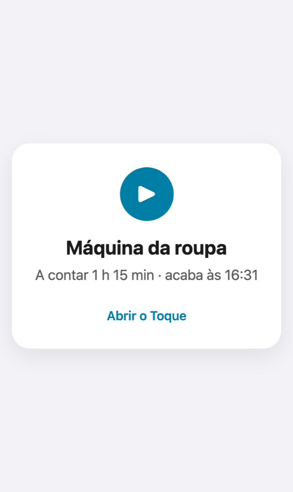
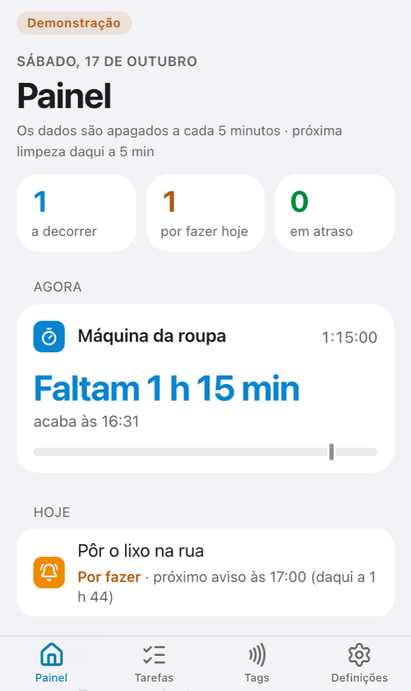
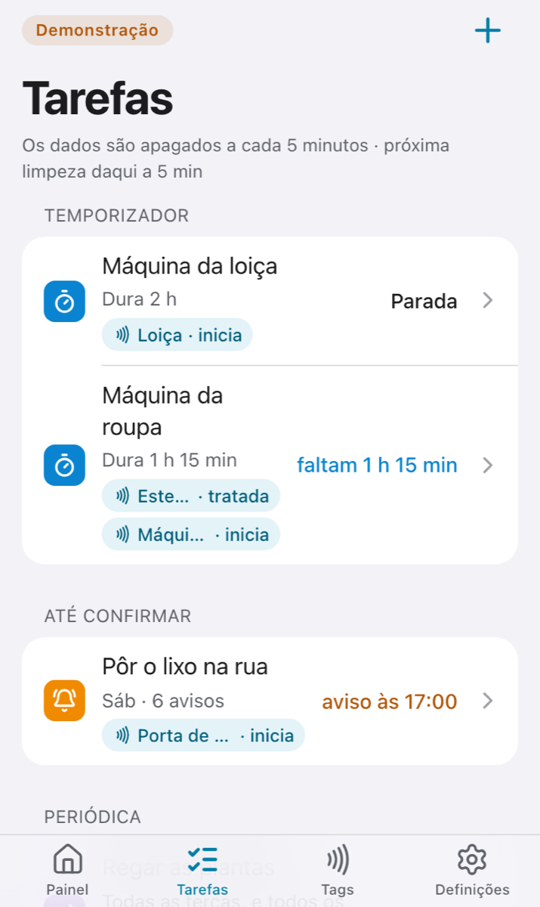

<div align="center">

# 📲 Toque

**Tarefas de casa que se registam com um toque do telemóvel numa tag NFC.**

Encostas o iPhone à máquina da roupa e o Toque começa a contar.
Quando acaba, avisa-te. Se te esqueceres da roupa lá dentro, volta a avisar.

[**Experimentar a demonstração →**](https://toque-demo.vercel.app)


</div>

<table>
<tr>
<td align="center" width="33%"><br><sub><b>1. Tocas na tag</b><br>Sem login: a tag é a chave.</sub></td>
<td align="center" width="33%"><br><sub><b>2. O painel mostra o que está a correr</b><br>Temporizadores e tarefas do dia.</sub></td>
<td align="center" width="33%"><br><sub><b>3. Cada tarefa tem as suas tags</b><br>Uma para começar, outra para dar como feita.</sub></td>
</tr>
</table>

<sub>Capturas da demonstração, com dados fictícios.</sub>

---

## Porquê

As tarefas de casa não precisam de mais uma lista: precisam de alguém que se lembre por ti no momento certo. Com uma tag colada no sítio onde a tarefa acontece, marcá-la custa um segundo. O Toque trata do resto: conta o tempo, manda os lembretes e insiste o que for preciso.

## Três tipos de tarefa

|     | Tipo              | Exemplo           | O que acontece |
| --- | ----------------- | ----------------- | -------------- |
| ⏱️  | **Temporizador**  | Máquina da roupa  | A tag da máquina inicia a contagem e o Toque avisa quando acaba. Se quiseres, lembra-te da "roupa esquecida" até tocares na tag do estendal. |
| 🔔  | **Até confirmar** | Pôr o lixo na rua | Nos dias de recolha manda avisos cada vez mais insistentes, até tocares na tag. |
| 🔁  | **Periódica**     | Regar as plantas  | Fica pendente nos dias que escolheres, ou a cada N dias depois do último toque. |

## O que faz

- **📲 Toque sem login.** Cada tag guarda um endereço `/t/<token>` e abri-lo regista o toque. O token é a credencial e só dá acesso àquela tarefa.
- **🏷️ Várias tags por tarefa**, cada uma com a sua ação: "inicia" (na máquina) ou "tratada" (no estendal).
- **🔔 Notificações com [ntfy](https://ntfy.sh).** Têm botões "Feito" e "Adiar", horas de silêncio e lembretes que vão subindo de tom.
- **📅 Google Calendar (opcional).** Cria um calendário "Toque" só da app, sem lembretes, e apaga cada evento quando a tarefa fica feita.
- **📊 Painel e histórico** de tudo o que foi tocado.
- **📱 PWA instalável** no ecrã principal do iPhone, em português e com a hora de Lisboa.
- **🔒 A app está protegida por uma palavra-passe;** só o toque nas tags é público.

## Como funciona

```text
 tag NFC ──► https://<o-teu-domínio>/t/<token> ──► Next.js (Vercel) ──► Postgres (Neon)
                                                        ▲
 cron-job.org ── a cada minuto ──► /api/tick ───────────┘──► ntfy ──► 📱 notificação
                                                         └─► Google Calendar (opcional)
```

| Peça        | Escolha |
| ----------- | ------- |
| App         | Next.js 16 (App Router), React 19, TypeScript, Tailwind |
| Dados       | Drizzle ORM: **Neon Postgres** em produção e **PGlite** em local, sem configurar nada |
| Alojamento  | Vercel Hobby, com as migrações aplicadas em cada deploy |
| Relógio     | cron-job.org chama `/api/tick` a cada minuto |
| Avisos      | ntfy.sh |
| Testes      | Vitest e Playwright (perfil iPhone / WebKit) |

Tudo cabe nos planos gratuitos.

## Começar

```bash
git clone https://github.com/gustavos00/toque.git
cd toque
npm install
cp .env.example .env.local   # preenche pelo menos TOQUE_PASSWORD e TOQUE_SESSION_SECRET
npm run dev                  # http://localhost:3000, com PGlite em .data/pglite
```

Sem `DATABASE_URL`, usa PGlite e migra automaticamente.

### Pôr online e ligar as peças

| Guia | Para quê |
| ---- | -------- |
| [Pôr online](docs/deploy.md) | Vercel, Neon e cron-job.org, com os segredos postos por `scripts/setup-vercel-env.sh` |
| [Notificações com ntfy](docs/ntfy.md) | Gerar um tópico privado e subscrevê-lo no iPhone |
| [Gravar as tags NFC](docs/tags-nfc.md) | Que tags comprar (e as de metal), e como gravar o endereço |
| [Google Calendar](docs/google-calendar.md) | Ligar o calendário (opcional) |
| [Demonstração pública](docs/demo.md) | Como funciona a demo: palavra-passe `demo` e dados apagados a cada 5 minutos |

## Testes

```bash
npm test               # unitários (Vitest)
npm run test:e2e       # ponta a ponta (Playwright, iPhone/WebKit, porta 4417)
npm run test:e2e:demo  # o mesmo, contra um build de demonstração (porta 4421)
npm run lint
npm run typecheck
```

Na primeira vez, corre `npx playwright install webkit`. O e2e faz `next build` e `next start` com uma base de dados PGlite em memória, por isso pode correr ao lado do teu `npm run dev`.

Base de dados:

- `npm run db:generate` cria as migrações a partir de `src/server/db/schema.ts`.
- `npm run db:migrate` aplica-as; com `DATABASE_URL`, aplica-as no Neon.

## Licença

[MIT](LICENSE) © Gustavo Santos
