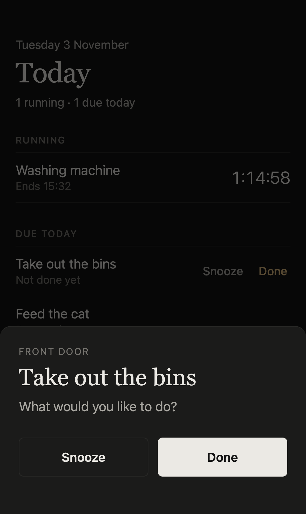
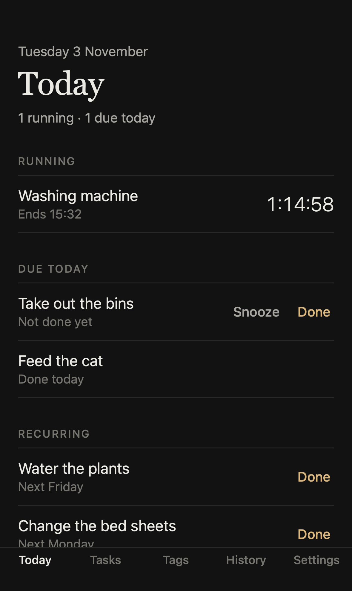
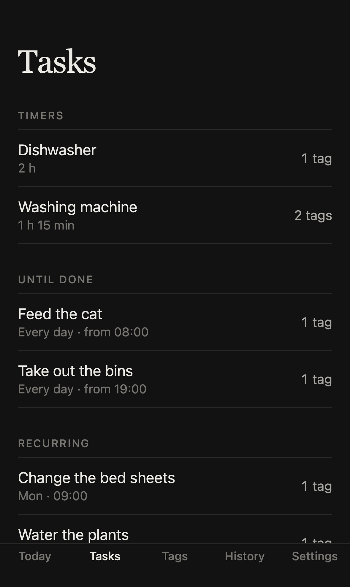

<div align="center">

# 📲 Toque

**Household tasks you log by tapping your phone on an NFC tag.**

Hold your iPhone against the washing machine and Toque starts counting down.
When it finishes, it notifies you. If you forget the laundry inside, it reminds you again.

[**Try the demo →**](https://toque-demo.vercel.app)


</div>

<table>
<tr>
<td align="center" width="33%"><br><sub><b>1. You tap the tag</b><br>The app asks what you did.</sub></td>
<td align="center" width="33%"><br><sub><b>2. Today shows what is running</b><br>Timers and the day's tasks.</sub></td>
<td align="center" width="33%"><br><sub><b>3. Each task has its own tags</b><br>One to start it, another to mark it done.</sub></td>
</tr>
</table>

<sub>Screenshots of the iPhone app with made-up data, made by <code>npm run screenshots</code>.</sub>

---

## Why

Household tasks don't need another list: they need someone to remember for you at the right moment. With a tag stuck where the task happens, logging it takes a second. Toque does the rest: it counts the time, sends the reminders and keeps nudging as much as needed.

## Three kinds of task

|     | Kind           | Example              | What happens |
| --- | -------------- | -------------------- | ------------ |
| ⏱️  | **Timer**      | Washing machine      | The machine's tag starts the countdown and Toque notifies you when it ends. Optionally, it reminds you about the "forgotten laundry" until you tap the tag on the drying rack. |
| 🔔  | **Until done** | Putting the bins out | On collection days it sends increasingly insistent alerts until you tap the tag. |
| 🔁  | **Recurring**  | Watering the plants  | It becomes pending on the days you choose, or every N days after the last tap. |

## What it does

- **📲 Tapping without a login.** Each tag stores a `/t/<token>` address, which opens the app on the iPhone; one more tap on "Done" logs it. The token is the credential and only gives access to that one task.
- **🏷️ Several tags per task**, each with its own action: "Start" (on the machine) or "Complete" (on the drying rack).
- **🔔 Notifications with [ntfy](https://ntfy.sh).** They have "Done" and "Snooze" buttons, quiet hours and reminders that grow more urgent.
- **📅 Google Calendar (optional).** Creates a "Toque" calendar used only by the app, without reminders, and deletes each event when the task is done.
- **📊 Today screen and history** of everything that was tapped.
- **📱 iPhone app** (Expo, in `mobile/`) that reads and writes the tags itself, in English and on Lisbon time. See [Install the app on the iPhone](docs/mobile.md).
- **🔒 The app is protected by a password;** only tapping the tags is public.

## How it works

```text
 tag NFC ──► https://<your-domain>/t/<token> ──► Next.js (Vercel) ──► Postgres (Neon)
                                                        ▲
 cron-job.org ── every minute   ──► /api/tick ───────────┘──► ntfy ──► 📱 notification
                                                         └─► Google Calendar (optional)
```

| Part        | Choice |
| ----------- | ------- |
| App         | iPhone app in Expo / React Native (`mobile/`); server and API in Next.js 16 (App Router), React 19, TypeScript |
| Data        | Drizzle ORM: **Neon Postgres** in production and **PGlite** locally, with no setup |
| Hosting     | Vercel Hobby, with migrations applied on every deploy |
| Clock       | cron-job.org calls `/api/tick` every minute |
| Alerts      | ntfy.sh |
| Tests       | Vitest and Playwright (iPhone profile / WebKit) |

Everything fits within the free plans.

## Getting started

```bash
git clone https://github.com/gustavos00/toque.git
cd toque
npm install
cp .env.example .env.local   # fill in at least TOQUE_PASSWORD and TOQUE_SESSION_SECRET
npm run dev                  # http://localhost:3000, with PGlite in .data/pglite
```

Without `DATABASE_URL`, it uses PGlite and migrates automatically.

### Deploying and connecting the parts

| Guide | Purpose |
| ----- | ------- |
| [Deploying](docs/deploy.md) | Vercel, Neon and cron-job.org, with the secrets set by `scripts/setup-vercel-env.sh` |
| [Notifications with ntfy](docs/ntfy.md) | Generate a private topic and subscribe to it on the iPhone |
| [Writing the NFC tags](docs/tags-nfc.md) | Which tags to buy (including metal-mount ones) and how to write the address |
| [Google Calendar](docs/google-calendar.md) | Connect the calendar (optional) |
| [Public demo](docs/demo.md) | How the demo works: password `demo` and data wiped every 5 minutes |

## Tests

```bash
npm test               # unit (Vitest)
npm run test:e2e       # end to end (Playwright, iPhone/WebKit, port 4417)
npm run screenshots    # docs/images/*.png from the app's web build and a demo server
npm run lint
npm run typecheck
```

The first time, run `npx playwright install webkit`. The e2e run does `next build` and `next start` with an in-memory PGlite database, so it can run alongside your `npm run dev`.

Database:

- `npm run db:generate` creates the migrations from `src/server/db/schema.ts`.
- `npm run db:migrate` applies them; with `DATABASE_URL`, it applies them to Neon.

## License

[MIT](LICENSE) © Gustavo Santos
